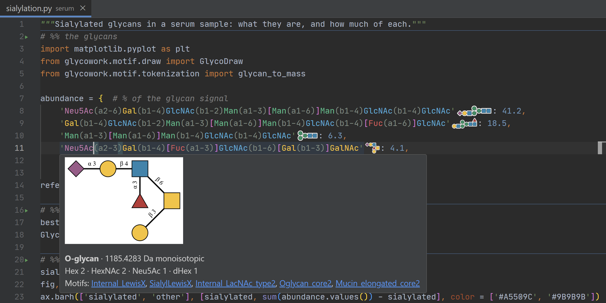
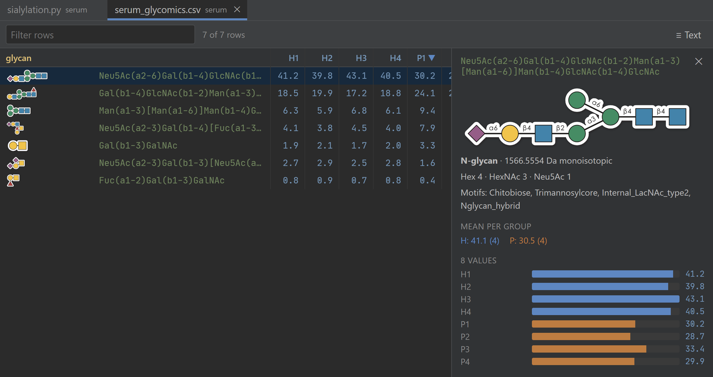
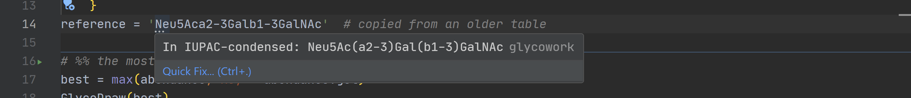
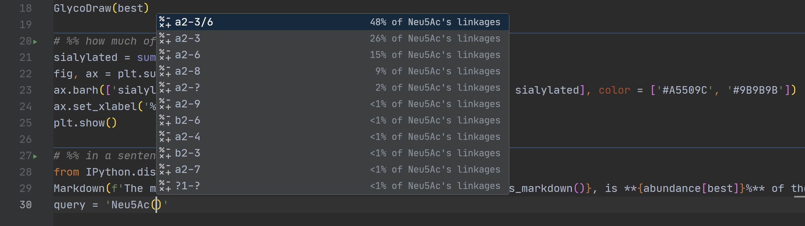
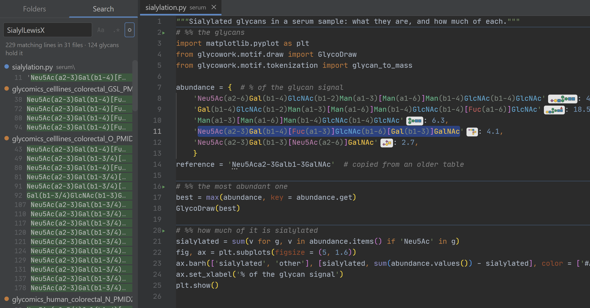
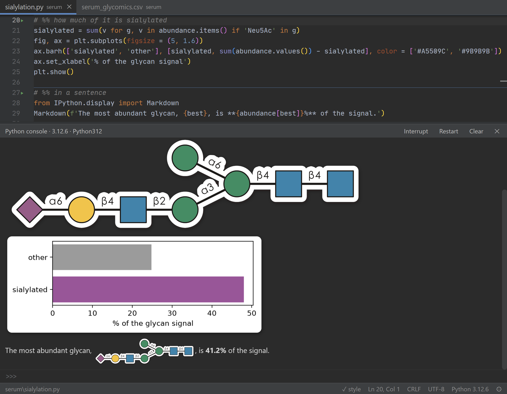
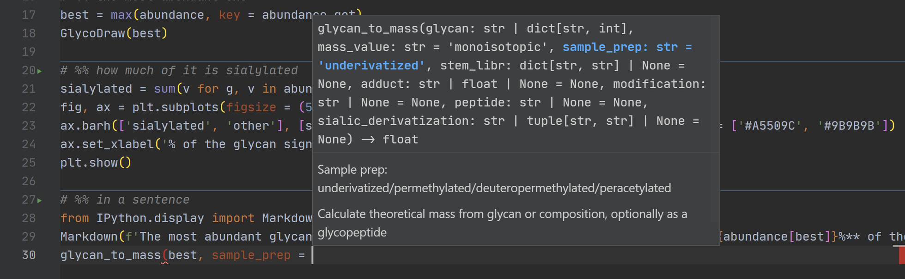

# slate

A Python editor made for glycobiology. It draws the glycans in your code in SNFG, shows GlycoDraw's drawings and your plots in its console, explains the functions of glycowork, CandyCrunch, glycorender and glycontact as you call them, and checks your code against the lab's coding standard as you type. It is also small: on Windows, with eight files and the console open, it uses about 430 MB of RAM where PyCharm used 4.5 GB, and a keystroke is on screen in 22 ms.

slate runs on Windows, macOS and Linux. It is Monaco (the editor component of VS Code) in the system's own web view (WebView2 on Windows, WebKit on macOS, WebKitGTK on Linux), driven by Python. macOS and Linux support are new: an automated test checks them on GitHub's Macs and Ubuntu machines (tools/smoke.py), but nobody uses them daily yet, so please report what looks or feels wrong. The figures in this README were measured on Windows.

## Made for glycobiology



* **Glycans you can see.** A string that reads as an IUPAC-condensed glycan, such as `'Neu5Ac(a2-3)Gal(b1-4)[Fuc(a1-3)]GlcNAc'`, gets a small SNFG drawing right after it, cut out as one of GlycoDraw's die-cut stickers (glycowork 1.10.1 or newer; older versions draw it on a grey box), and its residues are coloured as SNFG colours them (GlcNAc blue, Gal yellow, Fuc red, Neu5Ac purple; glycowork's palette), with the linkages dimmed. Test data and analysis scripts read like figures, and a typo that breaks a glycan shows up as a missing or wrong drawing before any test runs. Only the lines on screen are drawn and coloured, so glycowork's test file with over 2,000 glycans scrolls as fast as any other.
* **Glycans in your tables.** The same drawings, colours and hover cards appear in .csv, .tsv and .txt files, for every cell that holds an IUPAC-condensed glycan: glycowork's datasets, CandyCrunch's results, your own abundance tables. A quoted cell may contain commas (`"3,6-Anhydro-L-Gal(a1-3)Gal"`), and a cell may start with a digit (`6dTal(a1-3)Glc`). In glycowork's and CandyCrunch's data files that is 66,216 cells and 29,074 distinct glycans, and nothing that is not a glycan was taken for one. Tables are never checked, since they hold data as it was measured. With its drawings on screen, glycowork's 20,000-row lectin table scrolls (11 ms a frame) and types (22 ms a key) as fast as without them; after scrolling to three places in it, the window used about 80 MB more for the drawings it keeps, besides the drawing process. A table without glycans on screen starts nothing. Like the drawings in scripts, this works with glycowork 1.11.0 from PyPI or a checkout.
* **GlyTouCan IDs drawn too.** An ID such as `G00031MO`, in a script or a table, gets the drawing of the glycan glycowork gives it, and hovering shows that glycan with its card. glycowork 1.11.0 or newer knows 189,228 IDs (1.10.1: 47,349). slate reads them from glycowork's files once per glycowork version, in a process of its own (under 2 s), into a 14 MB index next to its settings, and looks IDs up there instead of holding them in memory: under a millisecond for a screenful.
* **Abundance tables as tables.** ⊞ Table in the status bar (or the tab's menu) shows a .csv, .tsv or .txt file as a table: aligned columns under a fixed header, every glycan drawn in its column, sorting by any column (click its header), a filter box (Ctrl+F), and a double-click to go to a row in the text. Clicking a row shows its glycan's drawing and card with the row's values as bars, coloured by sample group (CD1..CD17 and HFD1..HFD16 are two groups), and each group's mean. Hovering a glycan in an abundance table shows its row's values as small bars as well. The table is built when you open it and gone when you close it, and only the rows on screen are in the page: glycowork's 20,967-row lectin table opens in about 40 ms and sorts in 20-50 ms.

  
* **The paper behind a PMID or DOI.** Hovering over `PMID: 35112714`, a PubMed link or a DOI shows the paper's title, authors, journal and year, with links that open it on PubMed or doi.org. File names with a PMID, such as the 56 datasets in glycowork named like `glycomics_HIV_gagtransfection_N_PMID35112714.csv`, show their paper in their tooltip in the folder tree and on tabs. Only the identifier is sent, to PubMed or doi.org, only when you hover over it, and each paper is asked for once (1-2 s) and then remembered. It can be turned off in Settings.
* **A card for every glycan.** Hovering over a glycan shows the full drawing with linkages and, under it, what glycowork knows about it: its class (N-glycan, O-glycan, ...), monoisotopic mass, composition and the motifs it holds from glycowork's motif list, such as SialylLewisX or Oglycan_core1. Click a motif to find every glycan in your folders that holds it. A card takes a few milliseconds.
* **Glycans checked as you type.** A glycan glycowork cannot read, or one with a bracket that has no partner, gets a warning. A glycan in another notation, such as `'Neu5Aca2-3Galb1-4GlcNAc'` or a WURCS string, gets a hint whose quick fix (Ctrl+.) converts it to IUPAC-condensed, and one whose branches glycowork orders differently gets a hint to use glycowork's order, but only when that changes nothing but the order (an `a2-?` that glycowork would read as `a2-3/6` is left alone). Only glycans written as values are checked: never test files, where other notations and broken glycans are written on purpose, and never strings handed to `.replace`, `in` tests, `re`, glycowork's conversion functions or its glyco-regexes.

  
* **Glycans typed with you.** While you type a glycan in a string or a table cell, slate suggests what comes next, most common first: after `Neu5Ac(` the linkages Neu5Ac takes (a2-3/6 48%, a2-3 26%, a2-6 15%, ...), after `Neu5Ac(a2-3)` the monosaccharide it goes to (Gal 96%), and after a glycan's first three letters or a `[` the monosaccharides that start a chain. Picking a linkage brings up the next monosaccharide at once, so `Neu5Ac(a2-3)Gal(b1-4)[Fuc(a1-3)]GlcNAc` takes a few keys and Enters. The shares come from glycowork's 50,000 glycans, counted once per glycowork version (about 2 s, in a process of its own) into a 143 KB file. The page asks for them on the first glycan you type, and every suggestion after that is made in the page, in about 0.01 ms. Other strings, code and comments get nothing.

  
* **Search by motif.** The ⬡ button in Find in files turns the query into a glycan question: a motif from glycowork's list (suggested as you type), a substructure such as `Neu5Ac(a2-3)Gal`, a monosaccharide or a glyco-regex such as `Hex-HexNAc`. slate lists every line in your folders whose glycan holds it, in .py files and in .csv, .tsv and .txt tables. Searching glycowork and CandyCrunch (over 2,000 distinct glycans) takes about a second.

  
* **Drawn by glycowork itself.** The drawings, cards, checks and motif searches come from glycowork, run with the console's Python. With a glycowork checkout among your folders, they come from that checkout, so you see your working copy's drawings. The drawing process starts with the first glycan on screen and stops after 10 minutes without anything new to draw. glycowork 1.11.1 (on its dev branch) starts it in about 1.3 s and holds about 40 MB; with 1.11.0 from PyPI it takes about 2 s and 70 MB. Without glycowork, slate says so once and draws nothing.
* **A console that shows glycans and plots.** `GlycoDraw('Gal(b1-4)GlcNAc')` in the console shows the drawing below it, as in Jupyter. That needs glycowork 1.11.1; with 1.11.0, add `suppress = True`. glycowork's heatmaps, volcano plots and every other matplotlib or seaborn figure appear the same way. Right-click any of them to copy it for a slide. Markdown shows formatted, also with glycans in its sentences: `Markdown(f'binds {GlycoDraw(g, sticker = True).as_markdown()}')` (from `IPython.display`; `as_markdown` needs glycowork 1.11.1) draws the glycan in the line of text. As in Jupyter, `display()` shows several of these from one cell.

  
* **Analyses as cells.** Split an analysis script into `# %%` cells and run them one at a time with Shift+Enter, as in a notebook. The variables stay in the console between cells. Unlike a notebook, the file stays a plain .py file that git diffs, the coding standard checks and glycowork's tests can import.
* **glycowork's documentation as you type.** Typing a call to a glycowork, CandyCrunch, glycorender or glycontact function shows its parameters with their `# comments`, which is how glycowork documents parameters, and highlights the one you are typing. Hovering over a function shows its docstring, and Ctrl+click opens it. This works with these libraries installed with pip, for the Python that runs your project, and with their checkouts among your folders, which then win. The same goes for your own analysis code, and in the console for whatever you imported there. Other libraries such as pandas get no hints, since a hint for the wrong function is worse than none. The first time slate meets them installed, it reads them once (under a second for all four) and remembers them.

  
* **One editor for every project's environment.** Each folder can have its own Python, for example glycowork's development environment and CandyCrunch's PyTorch one. Code run from a file uses its project's Python, so the console imports the packages that project needs.
* **The lab's coding standard.** In a project with a `.github/scripts/check_style.py` (glycowork, CandyCrunch; the standard is in glycowork's CONTRIBUTING.md), the editor underlines what CI would flag, using that project's own checker. Shift+Alt+F reformats a file to the standard.
* **At home in a lab's folders.** Find in files skips mass spectrometry data files (.raw, .mzML, .mzXML, .wiff) and other binary files, so a project with data in it stays quick to search. On its first start, slate opens `Documents/glycowork` and `Documents/CandyCrunch` when they exist.

## Small and fast

slate's figures, measured on a 250% laptop screen with eight files and the console open:

* about 430 MB of RAM while you work, about 350 MB while another app is in front (PyCharm: 4.5 GB);
* 22 ms from keystroke to screen and 11 ms per scroll frame, the display's own frame time;
* style squiggles 0.3 s after you stop typing plus the check itself: about 0.2 s for a 2,400-line file, under 0.5 s for CandyCrunch's 5,400-line prediction.py;
* a double-clicked file on screen in about 1.8 s, and in 255 ms when slate is already open.

Every new feature is measured against these before it goes in (see Development), and anything heavy, such as the glycan drawing process, starts only when it is needed and stops when it is not.

## Requirements

* Windows 10 or 11. The WebView2 runtime and the .NET Framework 4 compiler that slate uses come with Windows.
* Or macOS 12 or newer. Everything slate uses to install itself comes with macOS.
* Or Linux with GTK 3 and WebKitGTK, which slate's window is made of, and PyGObject, through which Python uses them. On Ubuntu 22.04 or newer and Debian 12 or newer:
  ```
  sudo apt install python3-gi gir1.2-webkit2-4.1 python3-venv
  ```
  Other distributions have the same three under their own names (PyGObject, WebKitGTK 4.1 or 4.0 with its GObject introspection data, and Python's venv module).
* Python 3.10 or newer (tested with 3.12): from python.org on Windows; on macOS from python.org, Homebrew, conda or pyenv; on Linux the distribution's own `python3`. slate runs on this Python; the console can use a different one (see Settings).

## Install

1. Install slate and its dependencies (pywebview, jedi, pycodestyle) straight from GitHub:
   ```
   pip install git+https://github.com/Bribak/slate
   ```
   That needs git. Without git, install the same code as a zip:
   ```
   pip install https://github.com/Bribak/slate/archive/refs/heads/main.zip
   ```
   On Linux, install it into a virtual environment that sees the distribution's PyGObject (`--system-site-packages`; pip cannot install into the system's Python itself, and building PyGObject would need compilers and headers):
   ```
   python3 -m venv --system-site-packages ~/.local/share/slate-venv
   ~/.local/share/slate-venv/bin/pip install git+https://github.com/Bribak/slate
   ```
   and use `~/.local/share/slate-venv/bin/python` for `python` in step 2.
2. Install slate as an app, for your user only (no admin rights needed):
   ```
   python -m slate --install
   ```
   On Windows this adds slate to the Start menu and to Settings → Apps → Installed apps, and registers it for .py files. On macOS it makes `~/Applications/slate.app`, which Launchpad, Spotlight and Finder's Open With list, and which you can keep in the Dock. On Linux it adds slate with its icon to the desktop's app menu and to a .py file's Open With (a desktop entry and an icon in `~/.local/share`), from where you can pin it to the dock.
3. On macOS, to open .py files with slate by double-clicking: select one in Finder, **File → Get Info**, choose slate under **Open with**, then **Change All**. On Linux: right-click a .py file, **Properties → Open With** (wording differs by desktop), choose slate and set it as the default; or in a terminal, `xdg-mime default io.github.bribak.slate.desktop text/x-python text/x-python3`. The rest of this step is for Windows.

   Make slate the default for .py files. Windows does not let programs set this themselves, so it is one click: on the Settings page that step 2 opened (Default apps → slate), click **Set default**. If you closed it, double-click any .py file instead and answer Windows' "How do you want to open this file?" with **slate** and **Always**.

   If slate is not in that list: click **Choose an app on your PC** at the bottom. Paste this into the **File name** box and press Enter, then click **Always**:
   ```
   %LOCALAPPDATA%\Programs\slate\slate.exe
   ```
   That is `C:\Users\<your user name>\AppData\Local\Programs\slate\slate.exe`. Paste the path rather than browsing, because File Explorer hides the AppData folder.

Start slate from the Start menu, Launchpad or the app menu, by double-clicking a .py file, or with `slate` in a terminal (on Linux `~/.local/share/slate-venv/bin/slate`, unless that folder is on your PATH). On Windows, .py files that open in slate show slate's file icon in Explorer, and slate's window shows its own icon on the taskbar (pin it there to start it from the taskbar). Opening more files while slate is open adds them as tabs to the open window instead of starting another one; on macOS you can also drop files and folders on its Dock icon.

Run `python -m slate --install` again after upgrading or moving Python. `python -m slate --uninstall` removes everything step 2 added, as does uninstalling slate under Installed apps on Windows.

**Updates.** Once a day slate asks GitHub for its newest release. When there is a newer one, the status bar says "slate 0.3.0 is available"; click it to see what changed since your version and install it with pip (about 40 s), then restart slate. The first start after an update offers the same notes once in the status bar; all of them are in [CHANGELOG.md](CHANGELOG.md). A release is made automatically when a new version number reaches GitHub and slate has passed its tests in a real window on Windows, macOS and Linux (`.github/workflows/smoke.yml`), so an update installs exactly that tested version, never work in progress. Turn the check off in Settings. To work on slate itself, clone it and install with `pip install -e .` instead; such a checkout gets no update notices.

## Also a complete Python editor

* **Tabs from any number of projects.** Tabs wrap onto two rows at most; with more, both rows scroll sideways together, with the scrollbar or the mouse wheel, as in PyCharm, and the tab in front is always scrolled into view. Each tab is underlined in its folder's color and labelled with its project. Open tabs, cursor positions and folders come back on restart.
* **PyCharm-style colors and font.** Darcula colors and a Python grammar close to PyCharm's, with `self`, builtins, `def` names, decorators, keyword arguments, docstrings and f-string fields, and `TODO` and `FIXME` comments in PyCharm's yellow-green. The font is the JetBrains Mono that ships with PyCharm (or any JetBrains IDE) when one is installed, at PyCharm's default size; otherwise an installed JetBrains Mono, Cascadia Mono or Consolas.
* **Errors before you run.** Every .py file is compiled as you type, so syntax and indentation errors, `return` outside a function and similar mistakes are underlined in red, the tab name turns red, and the status bar names the error and line. SyntaxWarnings such as an invalid `"\d"` escape are underlined too.
* **Sharp on every monitor.** Text renders at each monitor's own scaling, and the window keeps its size when moved between a laptop screen and an external monitor. It reopens where it was closed, maximized (zoomed) or not.
* **Navigation.** Add project folders with **+** in the folder tree; several sit side by side. Ctrl+P finds a file by name across all of them (`name:120` jumps to line 120); before you type, it lists the open tabs, most recent first, and then the files you closed lately. Ctrl+Shift+F searches their contents. Ctrl+click or F12 goes to a definition: the open folders' own names (variables, functions, classes, methods, keyword arguments, imports) straight from the syntax tree, library code and attributes of objects through jedi. Ctrl+Alt+Left (or Alt+Left, or the mouse's back button) goes back to where you jumped from, as in PyCharm, and Ctrl+Alt+Right forward again; a jump is a definition, a search result, another tab or a move of ten lines or more, never typing or a click. Ctrl+F12 lists the file's classes and functions to jump to. Ctrl+Shift+Backspace goes to where you last changed something, and on each further press to the change before, as PyCharm's "last edit location" does.
* **Tabs and files.** Right-click a tab to close the others, the ones to its right or all unchanged ones, or to copy its path. **Compare with saved** shows a tab's unsaved changes against the file on disk, with a button to revert to it. Right-click a file or folder in the tree to rename it, which keeps its open tabs, or to delete it to the Recycle Bin (the Trash on macOS and Linux).
* **Local history.** As in PyCharm, every save keeps the version it replaced: right-click a tab and choose **Local history…** to see them by time, each as a side-by-side diff with the text now, and **Restore** one (an ordinary edit you can undo, saved when you save). That includes versions written by git, Claude or any other tool before you saved over them, which are always kept; slate's own saves are kept at most once a minute. The newest 50 versions of each file are kept for 30 days, next to slate's settings (`history` beside `state.json`), and files over 2 MB are not. A save takes under a millisecond longer, or about 20 ms when it keeps a version (Windows' virus scanner reads the old file first), off to the side so typing never waits; nothing else runs.
* **Console.** Ctrl+\` (Ctrl+Ö or the § key on Nordic keyboards) opens a Python console whose variables persist between runs. Enter runs the input, or adds a line while a block or bracket is still open. Shift+Enter always adds a line, and Ctrl+Enter always runs. Up and Down browse the history. **Interrupt** stops a run. **Restart** forgets all variables.
* **Running code from the editor.** Ctrl+Enter runs the selection in the console. Without a selection, it runs the cell at the cursor in a file with `# %%` cells, else the statement at the cursor. Shift+Enter does the same and moves on to the next cell or statement, as in Jupyter. F5 (or Shift+F10) runs the whole file as a script. The script starts with a fresh namespace, as `python file.py` would, and its variables stay in the console afterwards, so you can look at them. Each `# %%` line starts a cell, as in VS Code, Spyder and PyCharm. It gets a rule above it and a ▶ in the gutter that runs it. The console's working directory becomes the file's folder, so relative paths and sibling imports work. Tracebacks give the file's own line numbers, and clicking a `File "...", line N` line opens it there.
* **Figures in the console.** matplotlib and seaborn plots appear below the code that made them: every figure still open at the end of a run, and each `plt.show()`. So does anything that can draw itself for Jupyter. The newest 40 stay; older ones make room. Set `MPLBACKEND` yourself to use another matplotlib backend.
* **Coding standard details.** Reformatting (Shift+Alt+F) covers GW1, GW2 and the pycodestyle rules; GW3 stays underlined. It needs a version of `check_style.py` with `--fix`; with an older one, slate says so instead. Files outside a project with its own checker are checked with glycowork's if a glycowork checkout sits in `Documents/glycowork` (see `style_script` below), and are not checked otherwise.
* **Files changed outside slate.** Edits by git, Claude or any other tool are picked up within two seconds without moving your cursor. If you have unsaved edits in that file, a banner asks which version to keep.
* **Autosave.** As in PyCharm, changed files are saved when the slate window loses focus.

## Keys

On macOS, Cmd takes Ctrl's place, as in VS Code: Cmd+P, Cmd+S, Cmd+Enter. Ctrl+\`, Ctrl+Tab and Ctrl+C (interrupt) keep the Ctrl key. Cmd+, also opens the settings, Ctrl+R also runs the file (F5 needs Fn on most Mac keyboards), and Cmd+Option+Left/Right switch tabs. Back and forward are Ctrl+- and Ctrl+Shift+-, as in a Mac's VS Code. Alt is Option.

On Linux the keys are the same as on Windows. Where the desktop keeps Ctrl+Alt+Left/Right for switching workspaces (GNOME does), go back and forward with Alt+Left/Right or the mouse's side buttons.

The settings panel (Ctrl+Alt+S) lists them too, with a Mac's keys on a Mac.

| Key | Action |
| --- | --- |
| Ctrl+P / Ctrl+E | open file by name |
| Ctrl+Shift+F | find in files |
| Ctrl+Shift+E | folder tree |
| Shift+Alt+L | show the current file in the tree |
| Ctrl+B | show/hide the sidebar |
| Ctrl+\` | show/hide the console |
| Ctrl+S | save |
| Ctrl+W | close tab |
| Ctrl+Shift+T | reopen closed tab |
| Ctrl+Tab | previous tab (hold Ctrl and press Tab again to go further back) |
| Ctrl+PageUp/PageDown | tab to the left/right |
| Ctrl+Enter / Alt+Shift+E | run the selection, cell or statement in the console |
| Shift+Enter | the same, then go on to the next cell or statement |
| F5 / Shift+F10 | run the file in the console |
| Ctrl+Alt+S | settings, with all keys |
| Shift+Alt+F | reformat to the coding standard |
| Ctrl+F / Ctrl+H | find / replace in the file |
| F12 / Ctrl+click | go to definition |
| Ctrl+Alt+Left / Ctrl+Alt+Right | back / forward (also Alt+Left / Alt+Right and the mouse's buttons) |
| Ctrl+F12 | file structure: the file's classes and functions |
| Ctrl+Shift+Backspace | last edit location (press again for the one before) |
| F8 | next style finding |

In the console:

| Key | Action |
| --- | --- |
| Enter | run what was typed (a new line while a block is open) |
| Shift+Enter | new line |
| Ctrl+Enter | run, even an unfinished block |
| Up / Down | earlier / later input |
| Ctrl+C | interrupt (with nothing selected) |
| Ctrl+L | clear |
| Escape | back to the editor |

Everything else follows VS Code's keys.

## Settings

Ctrl+Alt+S, or the ⚙ at the right end of the status bar, opens the settings. Changes apply at once, except where they say otherwise.

* **Console Python.** You can set a default and one per open folder. The list offers each folder's virtual environment (`.venv`, `venv`), your conda environments and the Pythons installed from python.org (on Linux the system's, pyenv's and uv's); **Browse…** picks any other python.exe. Code run from a file (Ctrl+Enter, F5) uses its project's Python. If the console is running another Python, it restarts first, which clears its variables. The console also uses the project's Python when it starts or restarts while one of that project's files is in front. Any Python 3.8 or newer works, and the console imports packages from it. Without a setting, the console uses the Python slate runs on.

The settings live in `state.json` with your session: `%APPDATA%\slate\state.json` on Windows, `~/Library/Application Support/slate/state.json` on macOS, `~/.config/slate/state.json` on Linux. You can also edit it by hand with slate closed:

* `"console_python"`: the default python.exe for the console, e.g. `"C:\\Users\\you\\miniconda3\\envs\\glyco\\python.exe"`. `"console_pythons"` maps a folder (lower case, as `"c:\\users\\you\\documents\\glycowork"`) to its own.
* `"style_script"`: the `check_style.py` used for files outside any project with its own (default: `Documents\glycowork\.github\scripts\check_style.py`).
* `"autosave": false`: turns off saving when the window loses focus.
* `"usage_log": false`: turns off the local usage log (see Development).
* `"glycan_drawings": false`: no SNFG drawings next to glycans in the code.
* `"gpu": false`: software rendering, saving about another 100 MB. On high-resolution screens it is noticeably slower: at 250% scaling a keystroke took 52 ms to appear instead of 22 ms.
* `"update_check": false`: no daily check for a new version.

## Development

`python tools/smoke.py` opens slate in a real window with a throwaway session and checks the page, linting, the console, running cells, the settings panel, a key and a second launch; it prints the results and exits 1 if any failed. GitHub runs it on macOS, Windows and Ubuntu for every push (`.github/workflows/smoke.yml`), and on macOS also installs slate.app and opens a file with it, as it does with the desktop entry on Ubuntu.

`python tools/shots.py` makes the screenshots in `docs/` the same way, in a throwaway session with glycowork's checkout among its folders (Windows, needs Pillow); run it again when what they show changes.

`python tools/icons.py` redraws slate's file icon for .py files in Explorer (`slate/web/slate-file.ico`, needs Pillow) from the app icon's colours. `python tools/trailer.py OUT.mp4` makes slate's 25-second trailer from the screenshots in `docs/` (Windows, needs Pillow and ffmpeg).

`python -m slate --debug` opens slate with the web view's developer tools. `python tools/bench.py LABEL [--flags "<chromium flags>"] [--state '<state keys as JSON>'] [--line N]` measures startup, scroll and typing latency and RAM per process in a real window, with an isolated session; run it before and after any change that could affect speed or memory. `python tools/startup.py LABEL FILE` times a start that opens FILE, as a double-click does, in a copy of your session. `python -m slate.usage [days]` summarises `%APPDATA%\slate\usage.jsonl`, a local log of which calls ran and how long they took, slate's keys, errors with their stack traces, and window and monitor changes. It holds no file contents and is never sent anywhere. `python -m slate.devserver` serves the page at http://localhost:8765 to an ordinary browser, with the same backend over HTTP and a separate session. `bench.py` and `startup.py` measure through Windows tools and run on Windows only.

**Personal extensions.** Every `.js` file in the `extensions` folder next to `state.json` runs once when slate starts, with a `host` object that can add a sidebar view, open files, show a diff and react to focus and saves (see `host` in `slate/web/app.js`). The folder belongs to you, not to slate, so extensions stay on your machine. They run with slate's full rights: only put your own files there.
